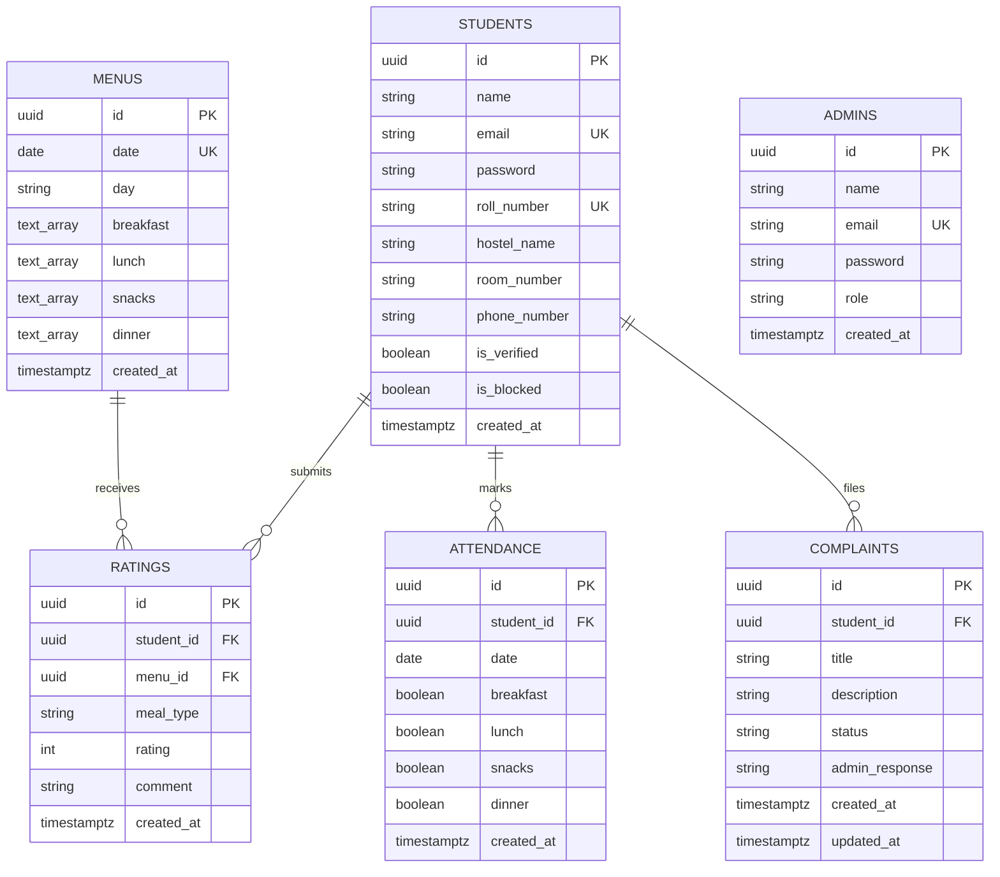

# SmartMess – Smart Hostel Mess Management System

[](backend/tests)
[](backend/coverage)
[](frontend/src/test)
[](https://nodejs.org/)
[](https://react.dev/)
[](#)

> **SmartMess** is an enterprise-grade, mobile-first web platform connecting hostel residents and mess administration to eliminate queues, food wastage, and communication gaps through transparent menu publishing, meal ratings, digital time-windowed attendance, complaint resolution, and data-driven demand forecasting.

---

## Table of Contents
1. [Problem Statement & Solution](#problem-statement--solution)
2. [Key Features & Functional Scope](#key-features--functional-scope)
3. [Technology Stack](#technology-stack)
4. [Project Directory Architecture](#project-directory-architecture)
5. [Database Schema](#database-schema)
6. [Getting Started (Local Installation)](#getting-started-local-installation)
7. [Running Automated Tests](#running-automated-tests)
8. [API Surface Reference](#api-surface-reference)
9. [SDLC Documentation Index](#sdlc-documentation-index)
10. [Deployment Guide](#deployment-guide)
11. [Project Team & Responsibilities](#project-team--responsibilities)

---

## Problem Statement & Solution

### The Challenge in Traditional Mess Operations
- **Menu Blindness:** Students walk to the hostel mess without visibility into daily or weekly menus, leading to dissatisfaction.
- **Lost Feedback:** Suggestions and quality complaints are scattered across informal WhatsApp groups or unrecorded verbal feedback.
- **Attendance Bottlenecks:** Paper-based signing or token systems cause long queues, proxy entries, and manual tallying errors.
- **Unaddressed Complaints:** Lack of a transparent ticketing platform leaves grievances unresolved.
- **Food Wastage & Over-Preparation:** Mess managers lack empirical demand data and prepare food based on crude guesswork, generating severe financial and environmental waste.

### The SmartMess Solution
SmartMess digitizes the entire lifecycle of hostel mess operations:
- **Mobile-First Student Portal:** Real-time today's menu, 7-day calendar, 1–5 star meal feedback, single-click digital attendance restricted to active meal windows, and structured grievance submission with real-time status tracking.
- **Administrative Command Center:** Daily/weekly menu planning with native HTML5 Drag-and-Drop dish ordering, student verification approval queue, user access control, grievance resolution, meal-by-meal attendance reporting with CSV export, and predictive analytics using moving averages for food demand forecasting.

---

## Key Features & Functional Scope

### 👨‍🎓 Student Portal
1. **Registration & Verification Gate:** Self-registration with roll number, hostel, room, and phone. Accounts remain locked (`is_verified = false`) until reviewed and approved by an administrator.
2. **Secure Authentication:** Stateless JWT authentication; clear error feedback for unverified or blocked accounts.
3. **Today's Menu:** Live cards for Breakfast, Lunch, Snacks, and Dinner with dish lists and timing indicators.
4. **Weekly Menu:** 7-day interactive view covering all meal slots.
5. **Meal Ratings:** 1–5 star ratings with optional qualitative comments; enforces one rating per meal per day with edit and delete capabilities.
6. **My Ratings History:** View past ratings, update feedback, or retract scores.
7. **Digital Attendance:** One-click meal attendance validation. Enforces that:
   - Attendance can only be logged for today.
   - Attendance can only be logged once per meal.
   - Attendance can only be logged within configurable operational hours (e.g., Breakfast: 07:30–09:30).
8. **Attendance History:** Chronological log of attended meals and monthly tallies.
9. **Complaints & Grievance Tracking:** Submit complaints with severity categorization; monitor status (`pending`, `in_progress`, `resolved`, `rejected`) and read administrator responses.
10. **Profile & Password Management:** Update room number and contact information; change account password with bcrypt hashing.

### 🛡️ Admin Portal
1. **Executive Dashboard:** High-level metrics showing total registered students, pending verification requests, overall mess satisfaction score, and unresolved grievances.
2. **Menu Management:**
   - Full CRUD operations on daily menus.
   - **HTML5 Drag-and-Drop:** Intuitive reordering of dishes within any meal slot without third-party libraries.
   - **Copy Previous Week:** One-click replication of the previous 7 days' menu to accelerate scheduling.
3. **Student Verification Queue:** Dedicated review table to approve or reject pending student registrations.
4. **Student Management:** Full directory search by roll number, name, or hostel; toggle block/unblock status and remove student records.
5. **Rating & Feedback Auditing:** Inspect meal feedback filtered by meal type, date range, or star rating.
6. **Complaint Resolution Center:** Filter complaints by status, update investigation stage, and post official admin responses.
7. **Attendance Reports & Export:** View meal-wise and date-wise attendance counts, with one-click **CSV export** for audit records.
8. **Analytics & Wastage Forecasting:**
   - Pure SVG Bar Charts showing average ratings per meal slot.
   - Pure SVG Line Charts illustrating 14-day satisfaction trends.
   - Top 5 highest-rated and lowest-rated dishes for menu optimization.
   - **7-Day Moving Average Attendance Forecast:** Algorithmic prediction of tomorrow's meal turnout to prevent overcooking and food wastage.

---

## Technology Stack

SmartMess strictly avoids third-party UI component libraries (no Tailwind, Bootstrap, MUI) and chart packages (no Chart.js, Recharts) in favor of standards-compliant HTML5, CSS Modules, and hand-crafted SVG visualizations.

| Tier | Technology | Version | Purpose |
| :--- | :--- | :--- | :--- |
| **Frontend Runtime** | React | `18.3.1` | Declarative component UI |
| **Build Tooling** | Vite | `5.4.11` | Hot module replacement & production bundling |
| **Client Routing** | React Router DOM | `6.28.0` | Client-side routing with role-based guards |
| **HTTP Client** | Axios | `1.7.9` | API requests with JWT Bearer interceptor |
| **Date Utility** | date-fns | `4.1.0` | Calendar calculations and timestamp formatting |
| **Toasts** | react-hot-toast | `2.4.1` | Non-blocking reactive notifications |
| **Icons** | react-icons | `5.4.0` | Lightweight Feather and Material iconography |
| **Styling** | Vanilla CSS Modules | — | Scoped, responsive, CSS custom property styling |
| **Backend Runtime** | Node.js | `18+` (LTS) | Asynchronous backend JavaScript execution |
| **Web Framework** | Express | `4.21.2` | RESTful API routes and controller middleware |
| **Database** | PostgreSQL (Supabase) | `15+` | Relational storage with foreign keys and triggers |
| **DB Client** | `@supabase/supabase-js` | `2.46.2` | Parametric query execution and connection pooling |
| **Authentication** | jsonwebtoken | `9.0.2` | Stateless signed HMAC-SHA256 bearer tokens |
| **Password Hashing** | bcrypt | `5.1.1` | Salted credential hashing (10 salt rounds) |
| **Security Headers** | Helmet | `8.0.0` | CSP, X-Frame-Options, HSTS headers |
| **Rate Limiter** | express-rate-limit | `7.4.1` | Brute-force protection on auth endpoints |
| **Validation** | express-validator | `7.2.0` | Schema-based payload validation & sanitization |
| **Backend Testing** | Jest & Supertest | `29.7.0` | Automated unit & integration testing |
| **Frontend Testing** | Vitest & React Testing Library | `2.1.8` | Component and workflow unit tests |

---

## Project Directory Architecture

```
SmartMess/
├── docs/                                  # Comprehensive SDLC Documentation
│   ├── 01_Project_Plan.md                 # Scope, Gantt, COCOMO, RACI matrix
│   ├── 02_SRS.md                          # IEEE 830/29148 Specification & Traceability Matrix
│   ├── 03_UML_Models.md                   # 13 Mermaid diagrams (Use Case, Class, Sequence, ER, DFD)
│   ├── 04_Architecture_Design.md          # 3-tier REST architecture, 7 ADRs, wireframes, OWASP
│   ├── 05_Implementation_Notes.md         # SOLID principles, coding standards, branch strategy
│   ├── 06_Test_Plan_and_Report.md         # 45 test cases, boundary analysis, coverage reports
│   └── 07_QA_and_Maintenance.md          # ISO 25010 checklist, maintenance plan, debt log
├── frontend/
│   ├── src/
│   │   ├── components/
│   │   │   ├── layout/                    # Navbar, Footer, Sidebar + CSS Modules
│   │   │   └── ui/                        # Button, Card, Modal, StarRating, Loader, EmptyState, ProtectedRoute
│   │   ├── context/                       # AuthContext (JWT management & global session)
│   │   ├── pages/                         # Student Pages: Landing, Login, Register, Dashboard, TodayMenu,
│   │   │                                  # WeeklyMenu, MyRatings, Attendance, Complaints, Profile
│   │   ├── pages/admin/                   # Admin Pages: AdminLogin, AdminDashboard, MenuManagement,
│   │   │                                  # StudentVerification, ManageStudents, ViewRatings,
│   │   │                                  # ComplaintManagement, AttendanceReports, Analytics
│   │   ├── services/                      # Axios instance with auth interceptor & API endpoints
│   │   ├── styles/                        # Design tokens (variables.css) and global baseline (global.css)
│   │   ├── test/                          # Vitest component & authentication test suites
│   │   ├── App.jsx                        # React Router switchboard with role guard wrappers
│   │   └── main.jsx                       # React DOM entry point
│   ├── public/                            # Static assets
│   ├── package.json
│   ├── vite.config.js
│   └── vercel.json                        # Vercel SPA routing rewrite rules
├── backend/
│   ├── src/
│   │   ├── config/
│   │   │   └── database.js                # Supabase PostgreSQL singleton client
│   │   ├── controllers/                   # authController, studentController, adminController
│   │   ├── middleware/                    # auth, roleGuard, rateLimiter, validator, errorHandler
│   │   ├── models/                        # Student, Admin, Menu, Rating, Attendance, Complaint
│   │   ├── routes/                        # authRoutes, studentRoutes, adminRoutes
│   │   ├── scripts/
│   │   │   └── createAdmin.js             # CLI provisioning script for mess administrators
│   │   ├── utils/
│   │   │   └── timeWindows.js             # Operational meal window validation
│   │   ├── app.js                         # Express application setup
│   │   └── server.js                      # HTTP server listener
│   ├── tests/
│   │   ├── unit/                          # Validator, time windows, middleware, model tests
│   │   └── integration/                   # Auth, student, admin, and security HTTP tests
│   ├── database_schema.sql                # Complete PostgreSQL DDL with indexes, checks, seeds
│   ├── .env.example
│   └── package.json
├── DEPLOYMENT.md                          # Production deployment guide (Supabase, Render, Vercel)
├── .gitignore                             # Environment and build artifact exclusions
└── README.md                              # Master project documentation
```

---

## Database Schema

The database is built on PostgreSQL with strict referential integrity, check constraints, composite unique keys, and B-tree indexes for query performance:



---

## Getting Started (Local Installation)

### 1. Prerequisites
- **Node.js**: v18.0.0 or higher
- **npm**: v9.0.0 or higher
- **Supabase Account**: A free project on [Supabase](https://supabase.com)

### 2. Database Provisioning
1. Open your Supabase Project Dashboard and navigate to the **SQL Editor**.
2. Open [`backend/database_schema.sql`](file:///c:/Users/Aadit/Downloads/se_project/backend/database_schema.sql) and paste the entire script into the editor.
3. Click **Run**. This creates:
   - All 6 tables with UUID primary keys.
   - Foreign key constraints with `ON DELETE CASCADE`.
   - Check constraints for meal types (`breakfast`, `lunch`, `snacks`, `dinner`), ratings (1–5), and complaint statuses (`pending`, `in_progress`, `resolved`, `rejected`).
   - Unique constraints preventing duplicate ratings or duplicate daily attendance records.
   - Sample weekly menu seed data and a verified demo student.

### 3. Backend Setup
1. Navigate to the `backend` directory:
   ```bash
   cd backend
   ```
2. Create your local environment configuration:
   ```bash
   cp .env.example .env
   ```
3. Update `.env` with your Supabase credentials:
   ```env
   PORT=5000
   NODE_ENV=development
   SUPABASE_URL=https://your-project-id.supabase.co
   SUPABASE_ANON_KEY=your-supabase-anon-key
   SUPABASE_SERVICE_ROLE_KEY=your-supabase-service-role-key
   JWT_SECRET=super_secret_jwt_passphrase_change_in_production
   JWT_EXPIRES_IN=7d
   FRONTEND_URL=http://localhost:5173
   ```
4. Install backend dependencies:
   ```bash
   npm install
   ```
5. **Create your initial Admin Account** (Admins cannot register via the public frontend):
   ```bash
   node src/scripts/createAdmin.js --name "Chief Warden" --email "admin@hostel.edu" --password "Admin@12345"
   ```
6. Start the backend development server:
   ```bash
   npm run dev
   ```
   *The server will start at `http://localhost:5000` with health check at `http://localhost:5000/api/health`.*

### 4. Frontend Setup
1. Navigate to the `frontend` directory in a new terminal:
   ```bash
   cd frontend
   ```
2. Install frontend dependencies:
   ```bash
   npm install
   ```
3. Start the Vite development server:
   ```bash
   npm run dev
   ```
4. Open your browser and navigate to `http://localhost:5173`.

---

## Running Automated Tests

The SmartMess test suite comprises **123 automated tests** across the stack, achieving verified industry-grade code coverage.

### Backend Tests (Jest & Supertest)
Run all 106 backend unit, controller, and integration suites:
```bash
cd backend
npm test
```

Generate the test coverage report:
```bash
npm run test:coverage
```
*Current Backend Coverage: **84.09% Line Coverage**, 0 failed test suites, 106 passed tests.*

Run the backend linter:
```bash
npm run lint
```

### Frontend Tests (Vitest & Testing Library)
Run all 17 component and UI integration tests:
```bash
cd frontend
npm test
```

Build the production bundle:
```bash
npm run build
```

Run the frontend linter:
```bash
npm run lint
```

---

## API Surface Reference

All responses adhere to a consistent standard JSON envelope:
```json
{
  "success": true,
  "message": "Operation description",
  "data": { ... }
}
```

### Authentication Endpoints (`/api/auth`)
| Method | Endpoint | Access | Description |
| :--- | :--- | :--- | :--- |
| `POST` | `/api/auth/register` | Public | Register a student account (starts as unverified) |
| `POST` | `/api/auth/login` | Public | Authenticate student; returns JWT bearer token |
| `POST` | `/api/auth/admin/login` | Public | Authenticate mess administrator; returns JWT |
| `GET` | `/api/auth/me` | Authenticated | Retrieve profile and role for active token |

### Student Endpoints (`/api/student`)
| Method | Endpoint | Access | Description |
| :--- | :--- | :--- | :--- |
| `GET` | `/api/student/menu/today` | Student | Fetch today's menu slots |
| `GET` | `/api/student/menu/weekly` | Student | Fetch 7-day weekly menu |
| `GET` | `/api/student/ratings` | Student | Retrieve all meal ratings submitted by student |
| `POST` | `/api/student/ratings` | Student | Submit 1–5 star rating for today's meal slot |
| `PUT` | `/api/student/ratings/:id` | Student | Modify an existing meal rating |
| `DELETE`| `/api/student/ratings/:id` | Student | Delete a meal rating |
| `GET` | `/api/student/attendance` | Student | Fetch attendance history for student |
| `POST` | `/api/student/attendance` | Student | Mark one-click attendance (meal-window enforced) |
| `GET` | `/api/student/complaints` | Student | List all complaints filed by student |
| `POST` | `/api/student/complaints` | Student | Submit a new grievance/complaint |
| `GET` | `/api/student/profile` | Student | Fetch student profile details |
| `PUT` | `/api/student/profile` | Student | Update room number and contact phone |
| `PUT` | `/api/student/password` | Student | Change account password with old password check |

### Admin Endpoints (`/api/admin`)
| Method | Endpoint | Access | Description |
| :--- | :--- | :--- | :--- |
| `GET` | `/api/admin/dashboard` | Admin | Get summary counters (students, complaints, rating) |
| `GET` | `/api/admin/menus` | Admin | Fetch all scheduled menus |
| `POST` | `/api/admin/menus` | Admin | Create daily menu |
| `PUT` | `/api/admin/menus/:id` | Admin | Update daily menu & dish order |
| `DELETE`| `/api/admin/menus/:id` | Admin | Delete a scheduled menu |
| `POST` | `/api/admin/menus/copy-week` | Admin | Copy previous 7 days' menu into a target week |
| `GET` | `/api/admin/students` | Admin | Search and filter student directory |
| `PUT` | `/api/admin/students/:id/verify` | Admin | Approve pending student registration |
| `PUT` | `/api/admin/students/:id/reject` | Admin | Reject student registration |
| `PUT` | `/api/admin/students/:id/block` | Admin | Block student from mess access |
| `PUT` | `/api/admin/students/:id/unblock`| Admin | Unblock student |
| `DELETE`| `/api/admin/students/:id` | Admin | Remove student record |
| `GET` | `/api/admin/ratings` | Admin | Audit meal ratings with meal/date/score filters |
| `GET` | `/api/admin/complaints` | Admin | List all student complaints |
| `PUT` | `/api/admin/complaints/:id` | Admin | Update status (`in_progress`/`resolved`) & reply |
| `GET` | `/api/admin/attendance/report` | Admin | Fetch aggregated meal attendance counts |
| `GET` | `/api/admin/attendance/export-csv` | Admin | Download raw attendance data as CSV |
| `GET` | `/api/admin/analytics/summary` | Admin | Aggregate rating breakdown per meal slot |
| `GET` | `/api/admin/analytics/dishes` | Admin | Retrieve Top 5 and Bottom 5 rated dishes |
| `GET` | `/api/admin/analytics/forecast` | Admin | 7-day moving average turnout prediction |

---

## SDLC Documentation Index

Comprehensive engineering documents adhering to standard software engineering course methodologies are available in the [`docs/`](file:///c:/Users/Aadit/Downloads/se_project/docs) directory:

1. [**01_Project_Plan.md**](file:///c:/Users/Aadit/Downloads/se_project/docs/01_Project_Plan.md)
   *Scope definition, Agile Scrum-lite methodology justification, feasibility analysis (technical, economic, operational), risk management matrix, 8-week Mermaid Gantt timeline, RACI matrix, and basic COCOMO effort estimation.*
2. [**02_SRS.md**](file:///c:/Users/Aadit/Downloads/se_project/docs/02_SRS.md)
   *IEEE 830/29148 Standard Software Requirements Specification. Includes 21 prioritized functional requirements (FR-STU-01..11, FR-ADM-01..10), 10 measurable NFRs, user stories with Gherkin acceptance criteria, detailed use case tables, and a full Requirements Traceability Matrix (RTM).*
3. [**03_UML_Models.md**](file:///c:/Users/Aadit/Downloads/se_project/docs/03_UML_Models.md)
   *13 high-resolution Mermaid diagrams: Complete Use Case Diagram, Domain Class Diagram, 5 Sequence Diagrams (JWT Auth, Verification Gate, Rating, Attendance Window, Complaint Lifecycle), 2 Activity Diagrams, 2 State Machines, Entity-Relationship Diagram, and Data Flow Diagrams (Level 0 Context & Level 1 Decomposition).*
4. [**04_Architecture_Design.md**](file:///c:/Users/Aadit/Downloads/se_project/docs/04_Architecture_Design.md)
   *3-tier Layered REST Architectural Pattern specification, Component Diagram, Production Cloud Deployment Topology, exhaustive API Specification tables, 7 Architectural Decision Records (ADRs), ASCII Wireframes, and OWASP Top 10 Security Mapping.*
5. [**05_Implementation_Notes.md**](file:///c:/Users/Aadit/Downloads/se_project/docs/05_Implementation_Notes.md)
   *Development guide detailing coding standards, SOLID principles application, module-to-requirements mapping, Git branching strategy, conventional commit specifications, and technical assumptions.*
6. [**06_Test_Plan_and_Report.md**](file:///c:/Users/Aadit/Downloads/se_project/docs/06_Test_Plan_and_Report.md)
   *Comprehensive verification documentation detailing test strategy, test environment, 45 test case specifications with Equivalence Partitioning & Boundary Value Analysis, actual Jest & Vitest execution metrics (84.09% line coverage), User Acceptance Testing (UAT) scripts, and defect tracking log.*
7. [**07_QA_and_Maintenance.md**](file:///c:/Users/Aadit/Downloads/se_project/docs/07_QA_and_Maintenance.md)
   *ISO/IEC 25010 Quality Assurance checklist, Code Review & CI/CD quality gates, 4-tier Software Maintenance Plan (Corrective, Adaptive, Perfective, Preventive), Semantic Versioning roadmap, System Extension Cookbook (push notifications, RFID/QR scanning), and Technical Debt Registry.*

---

## Deployment Guide

Full production deployment instructions, environment variable configurations, smoke testing procedures, and rollback runbooks are located in [**DEPLOYMENT.md**](file:///c:/Users/Aadit/Downloads/se_project/DEPLOYMENT.md).

- **Database:** Supabase Managed PostgreSQL
- **Backend Service:** Render Web Service (Node.js 18+ runtime)
- **Frontend SPA:** Vercel (Vite React static distribution with client-side rewrites)

---

## Project Team & Responsibilities

| Team Member | Primary Role | Key Deliverables & Responsibilities |
| :--- | :--- | :--- |
| **Member 1** | Frontend Lead | React SPA architecture, CSS Modules design system, Pure SVG charts, HTML5 Drag-and-Drop, Vitest UI testing |
| **Member 2** | Backend Lead | Express REST API, JWT authentication, role guards, meal window validation logic, Jest/Supertest integration suite |
| **Member 3** | Database & QA Lead | Supabase schema design, relational constraints, indexing, Test Plan (IEEE 829), boundary value analysis, UAT scenarios |
| **Member 4** | DevOps & Docs Lead | Project plan (Gantt/COCOMO), IEEE SRS specification, UML modeling, deployment runbooks (DEPLOYMENT.md), CI/CD quality gates |

---

## Academic Integrity & License
This project was developed as a comprehensive submission for the **Software Engineering (CS301)** course curriculum. All architectural designs, code artifacts, and documentation were constructed following rigorous software development lifecycle methodologies. Released under the [MIT License](LICENSE).
