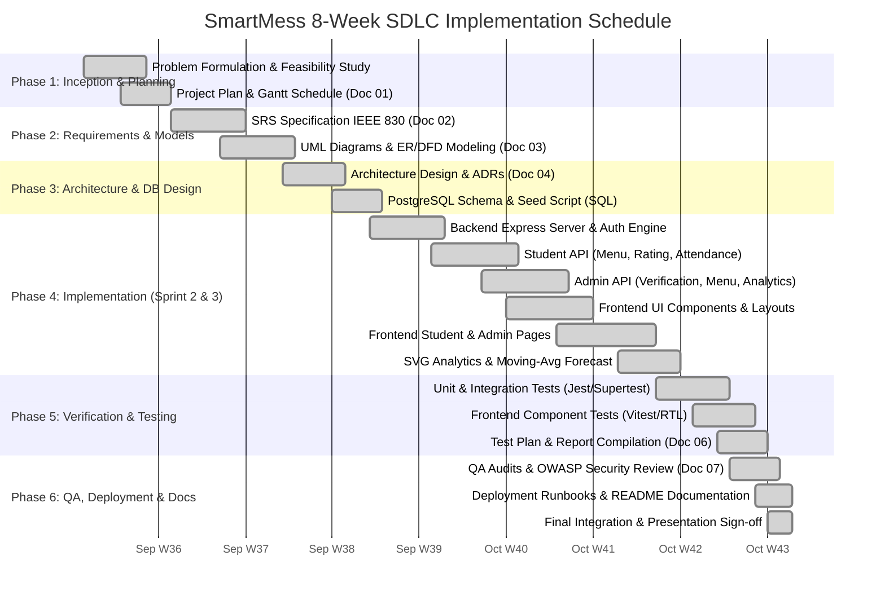

# SmartMess – Project Management & SDLC Plan
**Document ID:** SM-SDLC-01  
**Version:** 1.0.0  
**Date:** Academic Year 2024–2025  
**Project:** SmartMess – Smart Hostel Mess Management System  
**Prepared by:** Technical Lead & Senior Software Engineering Team  

---

## 1. Executive Summary & Project Objectives

### 1.1 Executive Summary
Hostel mess operations in higher educational institutions cater to hundreds or thousands of resident students daily. Currently, operations are plagued by manual, paper-based attendance, lack of real-time menu visibility, fragmented grievance redressal (via informal chat groups or verbal complaints), and complete absence of quantitative analytics on student preferences and wastage. **SmartMess** is an end-to-end, mobile-first web platform connecting hostel residents (Students) and mess administrators/wardens (Admins) to streamline daily operations, minimize food wastage through predictive attendance, and enforce accountability and transparency.

### 1.2 Core Project Objectives
1. **Real-time Menu Transparency:** Deliver accurate daily and weekly mess menus (Breakfast, Lunch, Snacks, Dinner) accessible 24/7 on mobile and desktop devices.
2. **Streamlined Grievance Redressal:** Provide a centralized digital portal to lodge, track, and resolve mess-related complaints with transparent status lifecycles (`pending` → `in_progress` → `resolved`/`rejected`).
3. **Structured Meal Feedback:** Enable verified students to submit 1–5 star ratings and qualitative comments on specific meals to establish quality benchmarks.
4. **Frictionless Digital Attendance:** Implement one-click, time-window-validated digital attendance per meal to eliminate paper registers and queue bottlenecks.
5. **Data-Driven Waste Reduction:** Provide mess managers with actionable analytics, dish ranking (top/bottom rated dishes), attendance trends, and a next-day moving-average attendance forecast for demand-driven procurement.
6. **Robust Access Control & Security:** Restrict full platform access to admin-verified students and provide role-based security using JSON Web Tokens (JWT) and encrypted credentials (bcrypt).

---

## 2. Project Scope

### 2.1 In-Scope Deliverables
* **Authentication & Authorization Subsystem:**
  * Student registration with university email, roll number, hostel name, room, and phone.
  * Account verification workflow (admin review before activation).
  * Secure role-based login (Student vs Admin) with JWT authentication and route guards.
  * Secure admin provisioning via a standalone CLI script (`createAdmin.js`).
* **Student Subsystem:**
  * Today's Menu view with dynamic highlight of current meal.
  * 7-day Weekly Menu view.
  * Meal rating (1–5 stars + optional comment) with uniqueness constraints and CRUD operations.
  * Meal attendance marking restricted to current calendar date and configurable time windows.
  * Attendance history view.
  * Complaint submission, status tracking, and view of administrative feedback.
  * Profile management and secure password change.
* **Administrator Subsystem:**
  * Dashboard with system KPIs: student counts, pending verifications, average ratings, open complaints.
  * Menu Management: Create, edit, delete daily menus; copy previous week menu; native drag-and-drop dish reordering.
  * Student Verification: Approve or reject student registrations.
  * Student Management: Search, filter by hostel/status, block/unblock, and delete student accounts.
  * Ratings & Feedback Explorer: Multi-criteria filtering by meal type, date range, and star rating.
  * Grievance Management: Update complaint statuses and attach formal admin responses.
  * Attendance Reports: Date-wise and meal-wise breakdown with CSV export capability.
  * Decision Analytics: Pure SVG/CSS visualizations showing average rating per meal/day, rating trends over time, top 5 and bottom 5 dishes, attendance trends, and next-day attendance forecast (7-day moving average).
* **Cross-Cutting Quality Deliverables:**
  * Centralized error handling and standardized response envelope (`{ success, message, data }`).
  * Unit, integration, and UI component test suites.
  * Full SDLC documentation suite (SRS, UML Models, Architecture Design, Implementation Notes, Test Plan & Report, QA & Maintenance Manual).

### 2.2 Out-of-Scope (Future Releases)
* Direct payment gateway integration for mess fee billing/rebates (handled out-of-band by university accounts).
* Biometric fingerprint or optical facial recognition attendance hardware.
* Push notification gateway via Apple APNS / Google FCM (simulated via in-app toast notifications and reactive polling).
* Native mobile applications (Android APK / iOS IPA) – addressed through mobile-first responsive Progressive Web Design.
* Multi-campus multi-tenant enterprise federation.

---

## 3. SDLC Methodology & Model Selection

### 3.1 Model Selection: Agile / Scrum-Lite (Incremental Sprints)
The project adopts an **Agile/Scrum-lite incremental methodology** structured into four distinct two-week sprints over an 8-week academic cycle.

```
+-----------------------------------------------------------------------------------+
|                           8-Week Agile Scrum-Lite Cycle                           |
+-----------------------------------------------------------------------------------+
| Sprint 1 (Weeks 1-2): Inception, SRS, UML Architecture & DB Schema Setup          |
| Sprint 2 (Weeks 3-4): Backend Core API, Auth Middleware, Student Core Modules     |
| Sprint 3 (Weeks 5-6): Admin Portal, Menu Drag & Drop, Complaints, SVG Analytics   |
| Sprint 4 (Weeks 7-8): Testing Suite, QA Audits, Vercel/Render CI/CD, Documentation|
+-----------------------------------------------------------------------------------+
```

### 3.2 Justification of SDLC Selection
1. **Requirements Clarity with Evolving Refinements:** While the core operational workflow of a mess is well understood, user experience flows (such as drag-and-drop menu creation, attendance time-window enforcement, and analytics charts) benefit from iterative prototyping.
2. **Early Integration & Risk Reduction:** Building a working vertical slice (Auth + Database + Menu) in Sprint 2 mitigates integration risks early, rather than discovering API mismatch in a late Waterfall integration phase.
3. **Continuous Testing:** In an academic software engineering project graded on code quality and test coverage (>=70% backend target), testing occurs concurrently within each sprint rather than as a delayed post-development phase.
4. **Predictable Milestone Cadence:** A bi-weekly sprint cadence provides clear deliverables for sprint reviews, code inspections, and documentation updates.

---

## 4. Feasibility Analysis

### 4.1 Technical Feasibility
* **Frontend:** Built with React 18 and Vite, ensuring near-instant HMR (Hot Module Replacement), fast bundle generation, and zero runtime dependencies on heavy component libraries. Custom CSS Modules eliminate CSS bloat and naming conflicts. Visualizations use pure SVG/CSS, eliminating third-party chart library bundle overhead.
* **Backend:** Node.js (v18+) and Express (v4.21.x) offer an asynchronous, event-driven, non-blocking I/O model well suited for concurrent student check-ins during peak mess meal windows (e.g., 7:30–9:30 AM).
* **Database:** Supabase-managed PostgreSQL 15 provides relational integrity, ACID compliance, native UUID generation, array data types for menu items, and foreign key cascades.
* **Conclusion:** The selected tech stack is mature, well-documented, standard in modern web engineering, and highly feasible.

### 4.2 Economic Feasibility
* **Infrastructure Costs:** Zero capital expenditure. All cloud tiers utilize free/developer-tier offerings:
  * Database: Supabase Free Tier (500 MB storage, 2 active projects).
  * Backend API: Render Free Web Service (512 MB RAM, shared CPU).
  * Frontend: Vercel Hobby Tier (Global Edge CDN, automatic SSL).
  * Development Tools: Git, GitHub, VS Code, Vitest, Jest (100% open source).
* **Operational ROI:** Replaces thousands of sheets of physical paper logs, reduces administrative labor by an estimated 15 hours/week, and prevents 10–15% food waste through attendance forecasting.
* **Conclusion:** The project is economically viable with zero budget barrier.

### 4.3 Operational Feasibility
* **User Acceptance:** Students already use smartphones; a mobile-first responsive web app eliminates the need for app store downloads.
* **Mess Staff Workload:** Mess supervisors can review ratings, approve registrations, update menus, and view attendance summaries from an intuitive dashboard without specialized technical training.
* **Administrative Policy:** Verification controls ensure that only bona fide hostel residents can participate in meal feedback and attendance, preventing spam and maintaining institutional governance.
* **Conclusion:** Highly feasible operational adoption.

---

## 5. Risk Assessment & Mitigation Matrix

| Risk ID | Risk Description | Severity | Likelihood | Mitigation Strategy |
| :--- | :--- | :--- | :--- | :--- |
| **RSK-01** | Peak Attendance Concurrency (hundreds marking attendance simultaneously) | High | Medium | Indexed `(student_id, date)` unique constraint, lightweight `UPDATE`/`INSERT` query, Express rate limiter with generous threshold for read/attendance endpoints. |
| **RSK-02** | Fraudulent Attendance Outside Meal Hours | High | High | Server-side validation enforcing strict meal time windows (e.g., Breakfast 07:00–10:00). Client clocks are disregarded. |
| **RSK-03** | Spam Registrations & Malicious Accounts | High | Medium | Two-stage onboarding: user is created with `is_verified = false`. JWT role guards block unverified students from sensitive endpoints until admin approves. |
| **RSK-04** | Render Free Tier Cold Starts (~50s delay on idle spin-up) | Medium | High | Frontend Axios interceptor detects slow requests and renders a user-friendly "Waking up server..." status toast with retry resilience. |
| **RSK-05** | Supabase Connection / Credential Drop | Critical | Low | Environment variable abstraction (`process.env.SUPABASE_URL`, `process.env.SUPABASE_KEY`), singleton database client, mocked unit/integration tests allowing full offline verification. |
| **RSK-06** | Browser Drag-and-Drop Incompatibilities | Low | Low | Native HTML5 Drag and Drop API with fallback keyboard/button reordering (`Move Up` / `Move Down`). |

---

## 6. Project Milestones & Deliverables

| Milestone | Deliverable Description | Target Week | Verification Criteria |
| :--- | :--- | :--- | :--- |
| **M1: Foundation & Planning** | Project Plan, IEEE SRS, UML Models | Week 2 | Documents approved, GitHub repo initialized, DB schema defined. |
| **M2: Core Architecture** | Architecture Document, Database Migration, Auth Engine | Week 4 | User registration, admin approval, JWT issuance, route guards operational. |
| **M3: Student Experience** | Menu Views, Rating Engine, Attendance Marking, Complaints | Week 6 | Student can view menus, mark attendance within time windows, rate meals, and log complaints. |
| **M4: Admin Capabilities** | Menu Drag-and-Drop, Student Verification, Grievance Redressal | Week 7 | Admin can approve students, edit menus with drag-and-drop, export attendance CSV, and reply to complaints. |
| **M5: Analytics & QA** | SVG Visualizations, Moving-Avg Forecast, Test Suite Execution | Week 8 | >=70% backend test coverage, frontend Vitest suite passing, automated QA checklist validated. |
| **M6: Release & Handover** | Deployment (Vercel + Render), Maintenance Manual, README | Week 8 | Zero lint errors, production build verified, complete documentation published. |

---

## 7. Project Schedule (8-Week Academic Timeline)



---

## 8. Team Responsibility Matrix (RACI Framework)

To replicate an authentic university software engineering team structure, responsibilities are mapped across four core team member roles using the RACI framework (**R**esponsible, **A**ccountable, **C**onsulted, **I**nformed):

| Project Module / Lifecycle Stage | Member 1 (Lead & Frontend) | Member 2 (Backend & Security) | Member 3 (Database & Testing) | Member 4 (DevOps & Docs) |
| :--- | :---: | :---: | :---: | :---: |
| **SDLC Planning & SRS Definition** | C | C | C | **R / A** |
| **UML Models & System Architecture** | C | **R / A** | C | C |
| **Database Schema, DDL & Indexes** | I | C | **R / A** | I |
| **Backend Express API & JWT Security**| C | **R / A** | C | I |
| **Frontend React Views & CSS Modules**| **R / A** | C | I | I |
| **Menu Drag & Drop & SVG Analytics**  | **R / A** | C | I | I |
| **Unit & Integration Test Suites**    | C | C | **R / A** | I |
| **Deployment Setup (Vercel & Render)**| I | C | I | **R / A** |
| **QA Audits & Maintenance Plan**      | C | C | C | **R / A** |

---

## 9. Tools, Technologies & Development Environment

| Category | Tool / Technology | Version / Configuration | Purpose |
| :--- | :--- | :--- | :--- |
| **Runtime Environment** | Node.js | v20.x LTS | JavaScript server-side execution runtime |
| **Package Manager** | npm | v10.x | Dependency management and script automation |
| **Backend Framework** | Express.js | 4.21.x | RESTful API server, routing, and middleware orchestration |
| **Database Provider** | Supabase PostgreSQL | v15.x | Relational database with row-level indexing and connection pooler |
| **Frontend Library** | React | 18.3.1 | Declarative component-based UI rendering |
| **Build Tooling** | Vite | 5.4.x | Fast frontend development server and ES module bundler |
| **Routing** | React Router | 6.28.0 | Client-side routing with nested layout and protected routes |
| **HTTP Client** | Axios | 1.7.9 | Promise-based HTTP client with request/response interceptors |
| **Date Utilities** | date-fns | 4.1.0 | Immutable date formatting, arithmetic, and validation |
| **Toast Notifications**| react-hot-toast | 2.4.1 | Lightweight, accessible user alert notifications |
| **Iconography** | react-icons | 5.4.0 | Feather and Material design iconography |
| **Testing Framework** | Jest & Supertest | 29.x / 7.x | Backend unit and API integration testing |
| **Frontend Testing** | Vitest & React Testing Library | 2.x / 16.x | JSDOM component rendering and user interaction assertions |
| **Code Quality** | ESLint & Prettier | Standard | Static analysis, linting, and deterministic formatting |

---

## 10. Effort Estimation (Story Points & Basic COCOMO)

### 10.1 Agile Story Point Estimation
The project scope was decomposed into 14 distinct functional user stories and evaluated using modified Fibonacci story points:

| Epic / Feature Area | Story ID | Story Title | Estimated Story Points |
| :--- | :--- | :--- | :---: |
| **Authentication** | US-01 | Student Registration & Approval Notification | 5 |
| | US-02 | Role-based Login (Student & Admin) & JWT Issuance | 3 |
| **Student Menu** | US-03 | Today's Menu with Active Meal Highlight | 3 |
| | US-04 | 7-Day Weekly Menu Calendar View | 3 |
| **Rating & Feedback** | US-05 | Meal Rating (1-5 Stars + Comment) Submission & CRUD | 5 |
| **Attendance** | US-06 | Time-Window Enforced One-Click Meal Attendance | 5 |
| | US-07 | Student Monthly Attendance History | 3 |
| **Complaints** | US-08 | Student Complaint Logging & Resolution Tracking | 5 |
| **Admin Operations** | US-09 | Admin Student Verification & Account Management | 5 |
| | US-10 | Menu Management with Native Drag-and-Drop Reordering | 8 |
| | US-11 | Grievance Response & Resolution Workflow | 3 |
| | US-12 | Attendance Report Filtering & CSV Export | 5 |
| **Analytics** | US-13 | Pure SVG Charts (Ratings & Attendance Trends) | 8 |
| | US-14 | Moving-Average Attendance Demand Forecasting | 5 |
| **Total Story Points** | | | **66 SP** |

*Team Velocity Assumption:* 16.5 Story Points / Sprint across a 4-person student team = Completed in exactly 4 Sprints (8 Weeks).

### 10.2 Basic COCOMO Estimation (Constructive Cost Model)
Using the Organic Mode (small team, familiar domain, flexible requirements):
* **Estimated Lines of Source Code (SLOC):** ~3,500 SLOC (excluding node_modules and configuration) = 3.5 KLOC.
* **COCOMO Constants (Organic):**
  $$\text{Effort} = a \times (\text{KLOC})^b \quad [a = 2.4, b = 1.05]$$
  $$\text{Effort} = 2.4 \times (3.5)^{1.05} \approx 2.4 \times 3.72 \approx 8.93 \text{ Person-Months}$$
* **Development Time ($T_{dev}$):**
  $$T_{dev} = c \times (\text{Effort})^d \quad [c = 2.5, d = 0.38]$$
  $$T_{dev} = 2.5 \times (8.93)^{0.38} \approx 2.5 \times 2.30 \approx 5.75 \text{ Months (Full-Time)}$$
* For an academic part-time team of 4 students dedicating 10–12 hours per week (~0.25 FTE per person = 1.0 FTE total), the estimated elapsed calendar schedule equates to 8–10 weeks, aligning with the planned 8-week sprint calendar.
