# SmartMess – System Modelling & UML Specification
**Document ID:** SM-SDLC-03  
**Version:** 1.0.0  
**Standard:** Unified Modeling Language (UML 2.5) / Structured Analysis  
**Project:** SmartMess – Smart Hostel Mess Management System  

---

## 1. Introduction
This document details the object-oriented and structured architectural models of the **SmartMess** system. It provides static domain representations (Class Diagram, ER Diagram), behavioral models (Use Case, Sequence, Activity, and State Diagrams), and structured data transformations (Data Flow Diagrams Level 0 and Level 1). All models use Mermaid syntax with explanatory narratives.

---

## 2. Use Case Model

### 2.1 Use Case Diagram
The Use Case Diagram depicts the functional interactions between the two core system actors: **Student** (Resident) and **Admin** (Mess Manager/Warden).

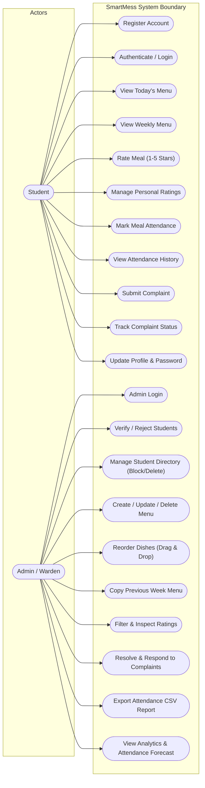

*Explanation:* Students interact with operational daily functions (menus, attendance, ratings, grievances), while Admins oversee master data (menu curation, user lifecycle approvals, grievance resolution, reporting, and forecasting).

---

## 3. Class Diagram

### 3.1 Domain & Service Class Diagram
The Class Diagram illustrates the structural entities, attributes, visibility, methods, and relationships within the backend layered architecture.

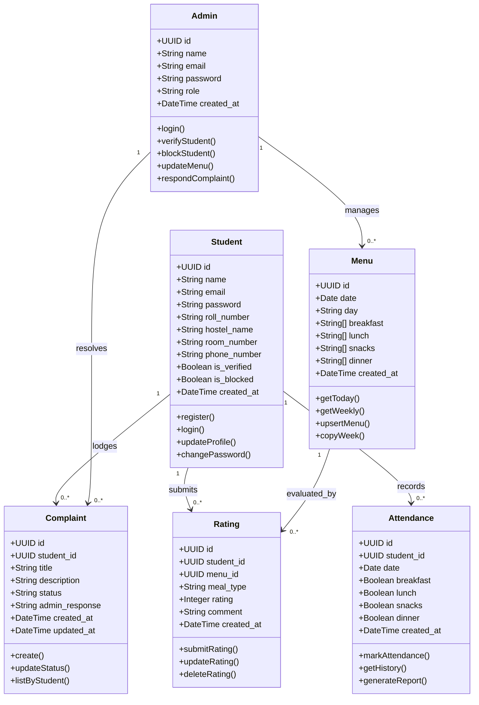

*Explanation:* The diagram shows strong associations where a `Student` can author multiple `Rating`, `Attendance`, and `Complaint` entities. A `Menu` is linked to multiple meal-specific `Rating` items. `Admin` orchestrates `Menu` updates and responds to `Complaint` items.

---

## 4. Sequence Diagrams

### 4.1 Sequence Diagram 1: Student Authentication & JWT Issuance

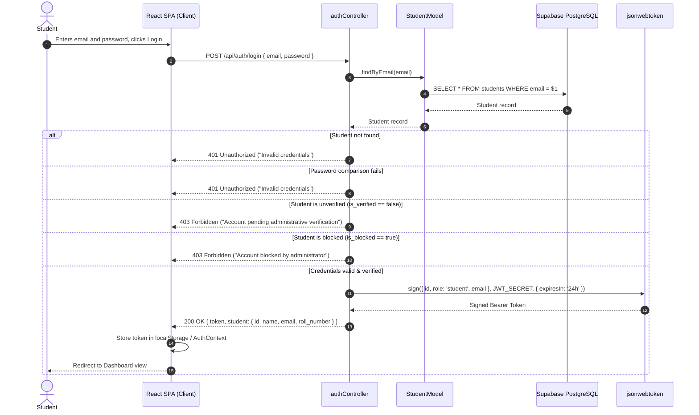

---

### 4.2 Sequence Diagram 2: Student Registration & Admin Verification Workflow

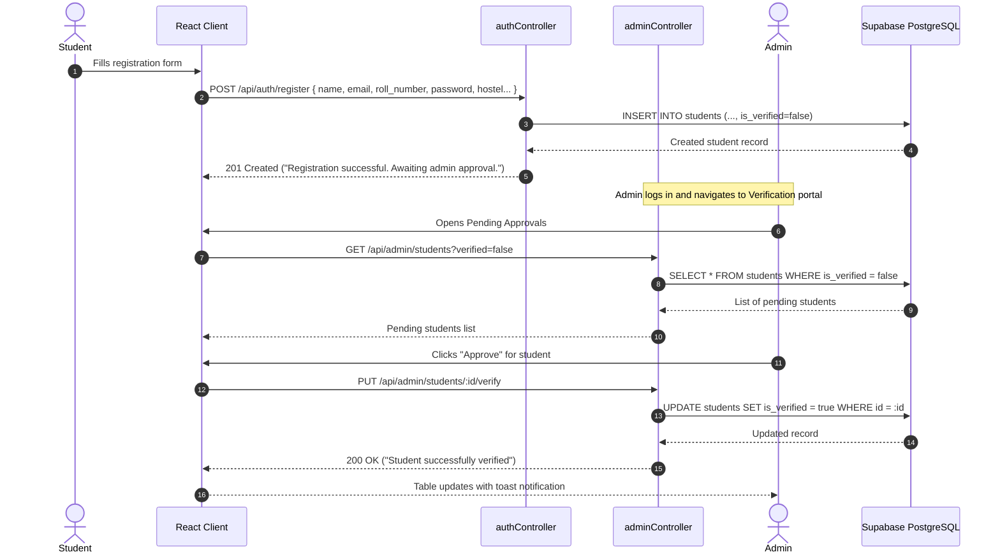

---

### 4.3 Sequence Diagram 3: Rate a Meal Flow

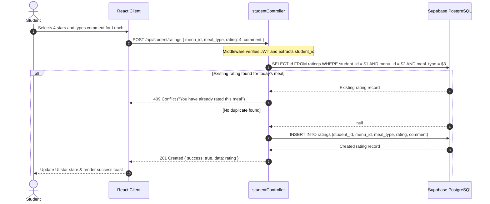

---

### 4.4 Sequence Diagram 4: Mark Attendance with Time Window Validation

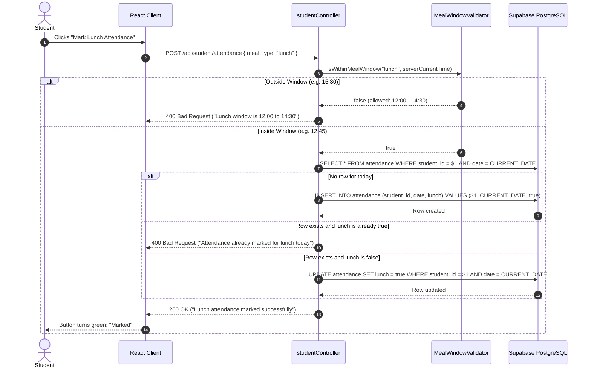

---

### 4.5 Sequence Diagram 5: Complaint Lifecycle & Administrative Redressal

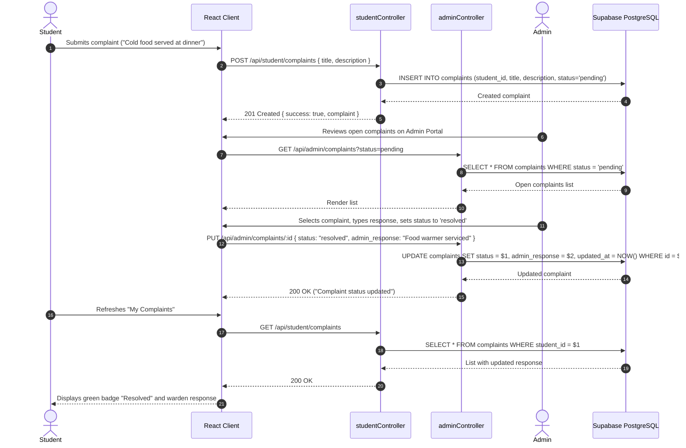

---

## 5. Activity Diagrams

### 5.1 Activity Diagram 1: Student Registration to Verification Flow

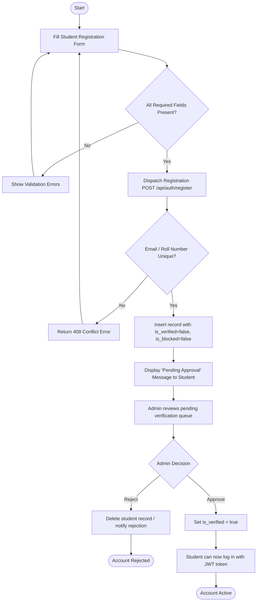

---

### 5.2 Activity Diagram 2: Attendance Marking Flow

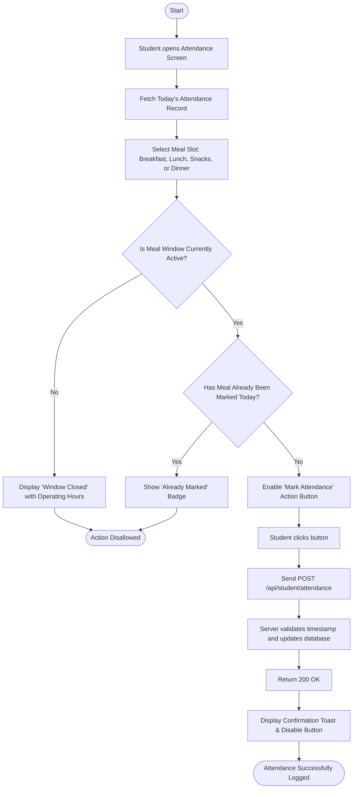

---

## 6. State Machine Diagrams

### 6.1 State Diagram 1: Grievance / Complaint Lifecycle

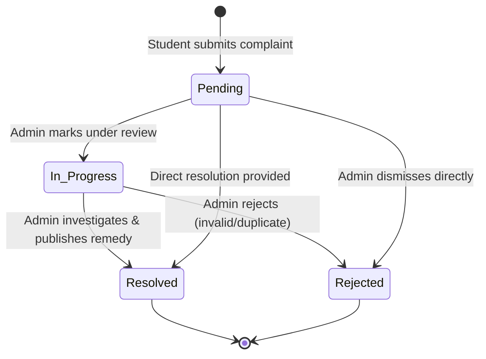

*Explanation:* A complaint enters the `Pending` state immediately upon submission. The mess warden transitions it to `In_Progress` when an investigation commences, and concludes it as either `Resolved` (with corrective action) or `Rejected` (with explanatory rationale).

---

### 6.2 State Diagram 2: Student Account Lifecycle

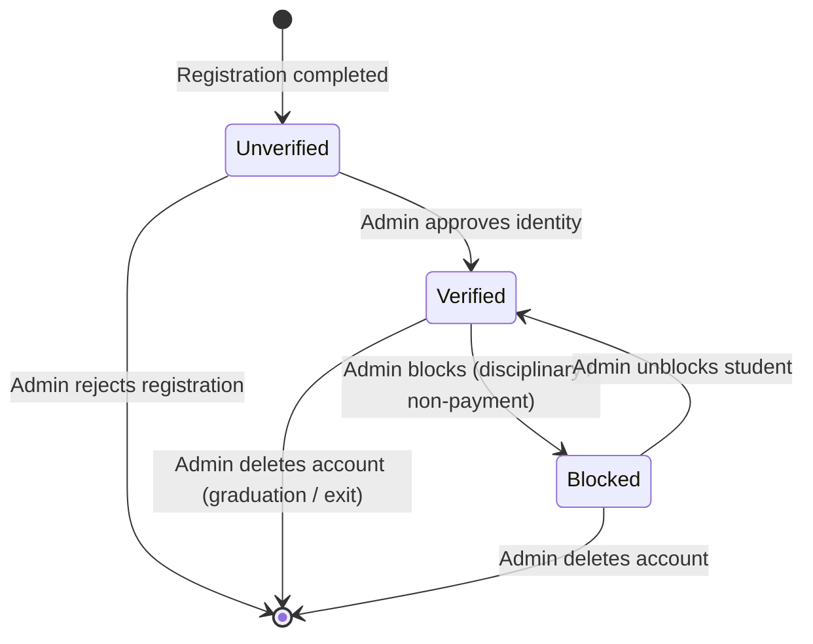

*Explanation:* Students commence in an `Unverified` holding state. Once `Verified`, they enjoy full student privileges. Disciplinary infractions or hostel exit allow transition to `Blocked` or permanent removal.

---

## 7. Entity-Relationship (ER) Diagram

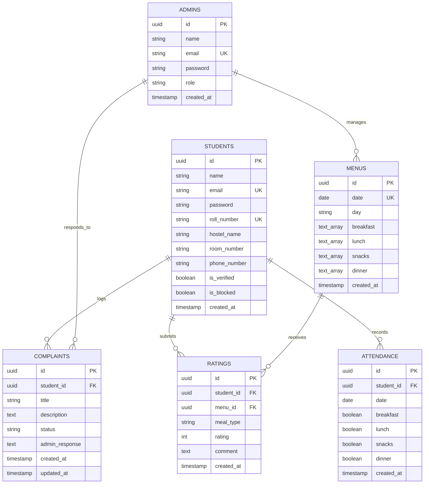

*Relational Constraints:*
* `RATINGS`: Unique composite constraint on `(student_id, menu_id, meal_type)` prevents multiple ratings per meal.
* `ATTENDANCE`: Unique composite constraint on `(student_id, date)` enforces a single daily attendance record per student.
* `MENUS`: Unique constraint on `date` guarantees exactly one published menu per calendar day.

---

## 8. Data Flow Diagrams (DFD)

### 8.1 DFD Level 0 (Context Diagram)

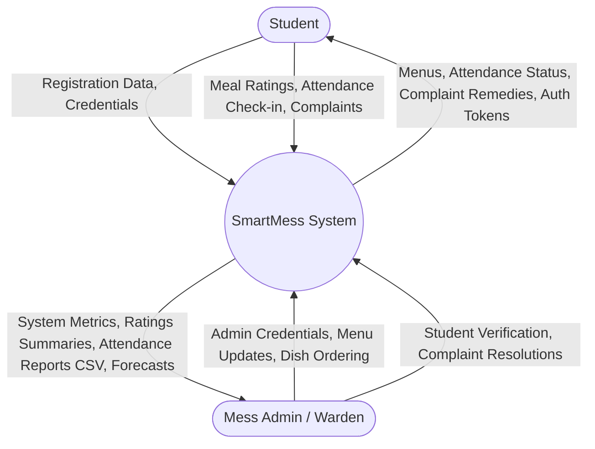

---

### 8.2 DFD Level 1 (Decomposition Diagram)

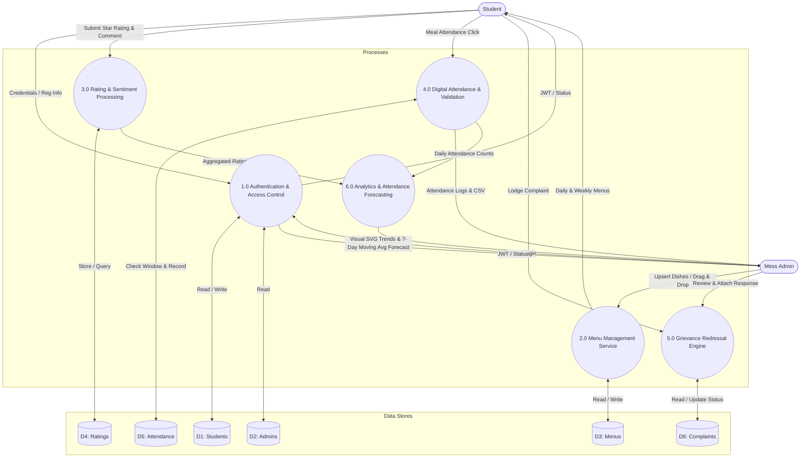
