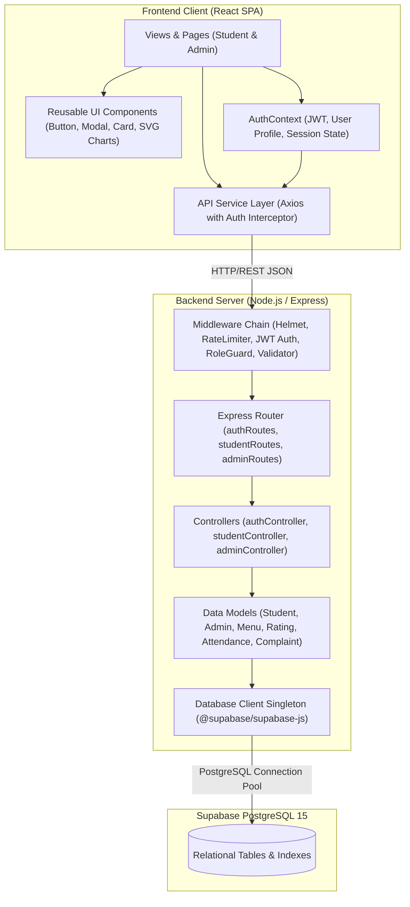

# SmartMess – Architecture & Technical Design Document
**Document ID:** SM-SDLC-04  
**Version:** 1.0.0  
**Status:** Approved  
**Project:** SmartMess – Smart Hostel Mess Management System  

---

## 1. Architectural Style & Overview
SmartMess adopts a **Three-Tier Client-Server Layered Architecture** with strict separation of presentation, business logic, and persistence concerns. The frontend operates as a decoupled Single Page Application (SPA), communicating with a stateless Node.js/Express RESTful micro-monolith, which interfaces with a cloud-managed PostgreSQL database.

```
+-----------------------------------------------------------------------------------+
|                           Presentation Layer (Tier 1)                             |
|  React 18 SPA + React Router 6 + CSS Modules + Axios Interceptor + Toast Alerts   |
+-----------------------------------------+-----------------------------------------+
                                          | HTTPS / REST (JSON)
+-----------------------------------------v-----------------------------------------+
|                          Application Logic Layer (Tier 2)                         |
|  Express 4 Middleware Chain -> Route Dispatchers -> Controllers -> Data Models    |
+-----------------------------------------+-----------------------------------------+
                                          | PostgreSQL Wire Protocol / SSL
+-----------------------------------------v-----------------------------------------+
|                            Data Persistence Layer (Tier 3)                        |
|        Supabase Managed PostgreSQL 15 (Relational Tables, Constraints, Indexes)   |
+-----------------------------------------------------------------------------------+
```

---

## 2. Component Diagram



---

## 3. Deployment Diagram

```mermaid
flowchart LR
    subgraph Client_Tier ["Client Tier (End-User Devices)"]
        Mobile["Mobile Web Browser (iOS / Android)"]
        Desktop["Desktop Web Browser (Chrome / Edge / Safari)"]
    end

    subgraph Cloud_Frontend ["Vercel Edge Platform"]
        VercelCDN["Vercel Global CDN (SSL / Edge Caching)"]
        StaticAssets["SPA Static Build (HTML5 / JS / CSS Modules)"]
        Rewrites["vercel.json SPA Route Rewriter"]
        VercelCDN --- StaticAssets
        VercelCDN --- Rewrites
    end

    subgraph Cloud_Backend ["Render Cloud Web Service"]
        RenderLoadBalancer["Render Reverse Proxy & SSL Termination"]
        NodeServer["Node.js 20 Express Service (Docker / Linux Container)"]
        EnvConfig["Environment Configuration (.env Injection)"]
        RenderLoadBalancer --- NodeServer
        NodeServer --- EnvConfig
    end

    subgraph Cloud_Database ["Supabase PostgreSQL Cloud"]
        PgBouncer["Supabase Connection Pooler"]
        PostgresDB[(PostgreSQL 15 Database Instance)]
        PgBouncer --- PostgresDB
    end

    Mobile -->|HTTPS :443| VercelCDN
    Desktop -->|HTTPS :443| VercelCDN
    StaticAssets -->|REST API Calls (HTTPS :443)| RenderLoadBalancer
    NodeServer -->|Encrypted DB Protocol :5432| PgBouncer
```

---

## 4. Module Responsibilities & Architectural Layering

| Layer | Module Name | Responsibilities |
| :--- | :--- | :--- |
| **Presentation** | `src/context/AuthContext` | Global user state, JWT storage in `localStorage`, reactive login/logout methods, token decoding. |
| | `src/services/api` | Centralized Axios instance, automatic `Authorization: Bearer <token>` attachment, 401 handling, timeout resilience. |
| | `src/components/ui` | Reusable atomic controls: `Button`, `Card`, `Modal`, `StarRating`, `Loader`, `EmptyState`, `ProtectedRoute`. |
| | `src/pages/admin` | Administrative interfaces: `AdminDashboard`, `MenuManagement`, `StudentVerification`, `ManageStudents`, `ViewRatings`, `ComplaintManagement`, `AttendanceReports`, `Analytics`. |
| | `src/pages` | Student interfaces: `Landing`, `Login`, `Register`, `Dashboard`, `TodayMenu`, `WeeklyMenu`, `MyRatings`, `Attendance`, `Complaints`, `Profile`. |
| **Routing & MW** | `middleware/auth` | Parses Bearer JWT, verifies signature, decodes claims, rejects expired tokens with 401. |
| | `middleware/roleGuard` | Verifies `role === 'admin'` or `role === 'student'`; rejects unauthorized role access with 403. |
| | `middleware/validator` | Validates payload schemas (email formats, password lengths, meal window rules). |
| | `middleware/rateLimiter` | Restricts rapid auth attempts (max 10 requests / 15 min window) to protect against brute force. |
| | `middleware/errorHandler` | Catches exceptions, standardizes JSON response envelope, obfuscates stack traces. |
| **Controller** | `controllers/authController` | Handles user registration, student login, admin login, token refresh, and `/me` profiling. |
| | `controllers/studentController` | Serves today/weekly menus, processes ratings, validates & records attendance, lodges complaints, updates profile. |
| | `controllers/adminController` | Manages menu CRUD & drag-drop arrays, executes approvals/blocks, responds to complaints, compiles CSV reports, calculates analytics & attendance forecast. |
| **Model** | `models/*` | Encapsulates parameterized database operations via the Supabase client singleton, enforcing SQL parameter isolation. |
| **Database** | `config/database.js` | Exports a singleton instance of the Supabase client initialized from environment variables. |

---

## 5. RESTful API Specification

All endpoints communicate via JSON and adhere to the canonical response envelope:
```json
{
  "success": true,
  "message": "Human readable status description",
  "data": {}
}
```

### 5.1 Authentication Endpoints (`/api/auth`)

| Method | Endpoint | Auth | Request Body | Response (200/201) | Error Codes |
| :--- | :--- | :---: | :--- | :--- | :---: |
| `POST` | `/api/auth/register` | Public | `{ name, email, password, roll_number, hostel_name, room_number, phone_number }` | `{ success: true, message: "Registration successful. Awaiting admin approval." }` | 400, 409 |
| `POST` | `/api/auth/login` | Public | `{ email, password }` | `{ success: true, data: { token, student } }` | 400, 401, 403 |
| `POST` | `/api/auth/admin/login` | Public | `{ email, password }` | `{ success: true, data: { token, admin } }` | 400, 401, 403 |
| `GET` | `/api/auth/me` | Bearer | None | `{ success: true, data: { user } }` | 401 |

### 5.2 Student Endpoints (`/api/student`)

| Method | Endpoint | Auth | Request Body | Response | Error Codes |
| :--- | :--- | :---: | :--- | :--- | :---: |
| `GET` | `/api/student/menu/today` | Student | None | `{ success: true, data: { menu, todayRating } }` | 401, 404 |
| `GET` | `/api/student/menu/weekly` | Student | `?start_date=YYYY-MM-DD` | `{ success: true, data: [ menus ] }` | 401 |
| `GET` | `/api/student/ratings` | Student | None | `{ success: true, data: [ ratings ] }` | 401 |
| `POST` | `/api/student/ratings` | Student | `{ menu_id, meal_type, rating, comment }` | `{ success: true, data: rating }` | 400, 409 |
| `PUT` | `/api/student/ratings/:id` | Student | `{ rating, comment }` | `{ success: true, data: updatedRating }` | 400, 404 |
| `DELETE` | `/api/student/ratings/:id` | Student | None | `{ success: true, message: "Rating deleted" }` | 404 |
| `GET` | `/api/student/attendance` | Student | `?month=MM&year=YYYY` | `{ success: true, data: { today, history } }` | 401 |
| `POST` | `/api/student/attendance` | Student | `{ meal_type }` | `{ success: true, data: attendance }` | 400, 409 |
| `GET` | `/api/student/complaints` | Student | None | `{ success: true, data: [ complaints ] }` | 401 |
| `POST` | `/api/student/complaints` | Student | `{ title, description }` | `{ success: true, data: complaint }` | 400 |
| `GET` | `/api/student/profile` | Student | None | `{ success: true, data: studentProfile }` | 401 |
| `PUT` | `/api/student/profile` | Student | `{ room_number, phone_number }` | `{ success: true, data: updatedProfile }` | 400 |
| `PUT` | `/api/student/password` | Student | `{ current_password, new_password }` | `{ success: true, message: "Password updated" }` | 400, 401 |

### 5.3 Administrator Endpoints (`/api/admin`)

| Method | Endpoint | Auth | Request Body | Response | Error Codes |
| :--- | :--- | :---: | :--- | :--- | :---: |
| `GET` | `/api/admin/dashboard` | Admin | None | `{ success: true, data: { stats, recentRatings, openComplaints } }` | 401, 403 |
| `GET` | `/api/admin/menus` | Admin | `?date=YYYY-MM-DD` or `?week_start=YYYY-MM-DD` | `{ success: true, data: menus }` | 401, 403 |
| `POST` | `/api/admin/menus` | Admin | `{ date, day, breakfast, lunch, snacks, dinner }` | `{ success: true, data: menu }` | 400, 409 |
| `PUT` | `/api/admin/menus/:id` | Admin | `{ breakfast, lunch, snacks, dinner }` | `{ success: true, data: updatedMenu }` | 400, 404 |
| `DELETE`| `/api/admin/menus/:id` | Admin | None | `{ success: true, message: "Menu deleted" }` | 404 |
| `POST` | `/api/admin/menus/copy-week` | Admin | `{ from_week_start, to_week_start }` | `{ success: true, message: "Week copied" }` | 400 |
| `GET` | `/api/admin/students` | Admin | `?verified=bool&search=str&hostel=str` | `{ success: true, data: [ students ] }` | 401, 403 |
| `PUT` | `/api/admin/students/:id/verify` | Admin | None | `{ success: true, message: "Student verified" }` | 404 |
| `PUT` | `/api/admin/students/:id/reject` | Admin | `{ reason }` | `{ success: true, message: "Student rejected" }` | 404 |
| `PUT` | `/api/admin/students/:id/block` | Admin | None | `{ success: true, message: "Student blocked" }` | 404 |
| `PUT` | `/api/admin/students/:id/unblock` | Admin | None | `{ success: true, message: "Student unblocked" }` | 404 |
| `DELETE`| `/api/admin/students/:id` | Admin | None | `{ success: true, message: "Student deleted" }` | 404 |
| `GET` | `/api/admin/ratings` | Admin | `?meal_type=str&date_from=str&rating=int` | `{ success: true, data: [ ratings ] }` | 401, 403 |
| `GET` | `/api/admin/complaints` | Admin | `?status=pending|resolved|etc` | `{ success: true, data: [ complaints ] }` | 401, 403 |
| `PUT` | `/api/admin/complaints/:id` | Admin | `{ status, admin_response }` | `{ success: true, data: updatedComplaint }` | 400, 404 |
| `GET` | `/api/admin/attendance/report` | Admin | `?date_from=YYYY-MM-DD&date_to=YYYY-MM-DD` | `{ success: true, data: { records, summary } }` | 401, 403 |
| `GET` | `/api/admin/attendance/export-csv` | Admin | `?date_from=YYYY-MM-DD&date_to=YYYY-MM-DD` | `text/csv` attachment file download | 401, 403 |
| `GET` | `/api/admin/analytics/summary` | Admin | None | `{ success: true, data: { mealRatings, dailyTrends, topDishes, bottomDishes, attendanceTrends, forecast } }` | 401, 403 |
| `GET` | `/api/health` | Public | None | `{ success: true, uptime, timestamp, db_status }` | 200 |

---

## 6. Design Patterns Used & Justification

1. **Layered Architecture / MVC:** Decouples the HTTP representation layer (`routes`), business decision workflows (`controllers`), and data persistence (`models`). This prevents data layer changes from breaking UI contracts and facilitates unit testing.
2. **Repository / Model Pattern:** The `models/` directory abstracts all database interactions. Controllers never construct raw SQL queries; they call domain methods such as `Menu.findByDate(date)`, enabling straightforward mocking in test suites without requiring a live Supabase connection.
3. **Middleware Chain (Pipes and Filters):** Request processing passes sequentially through `helmet` (security headers) → `rateLimiter` (brute force protection) → `auth` (JWT verification) → `roleGuard` (authorization) → `validator` (schema sanitization). Each filter encapsulates a single concern and rejects invalid requests early.
4. **Singleton Pattern:** The Supabase client in `src/config/database.js` maintains a single shared connection instance across the application lifecycle, avoiding redundant TCP handshake overhead.
5. **Context / Provider Pattern (React):** `AuthContext` provides global authentication state and user details to deeply nested components without prop-drilling, managing JWT storage and automatic 401 session resets.

---

## 7. Architecture Decision Records (ADRs)

### ADR-01: Supabase Managed PostgreSQL vs. MongoDB
* **Context:** The system manages structured data with relational constraints (students authoring ratings and attendance records tied to daily menus).
* **Decision:** Selected Supabase-managed PostgreSQL 15 over MongoDB.
* **Justification:** Relational integrity, foreign key cascades (`ON DELETE CASCADE`), native unique composite constraints (`student_id`, `menu_id`, `meal_type`), and PostgreSQL native text array types (`text[]` for dishes) match our domain perfectly. ACID compliance is mandatory for attendance records.

### ADR-02: Stateless JWT vs. Stateful Server Sessions
* **Context:** The backend is deployed on Render's serverless/container environment which may scale or spin down.
* **Decision:** Adopted stateless HMAC-SHA256 signed JSON Web Tokens (JWT) stored in client memory/localStorage.
* **Justification:** Eliminates the need for a shared session cache (such as Redis), lowers server memory footprint, and simplifies horizontal scaling across cloud instances.

### ADR-03: REST vs. GraphQL
* **Context:** The system requires predictable, cacheable, and easily testable endpoints with consistent envelopes.
* **Decision:** Adopted RESTful JSON APIs.
* **Justification:** Standard HTTP status codes (200, 201, 400, 401, 403, 404, 409) provide clear semantics. Supertest integration testing of REST is straightforward and reliable compared to GraphQL schema overhead.

### ADR-04: CSS Modules vs. Tailwind / Component Libraries
* **Context:** University project evaluation requires demonstrable understanding of core web styling without third-party design crutches.
* **Decision:** Implemented custom scoped CSS Modules (`*.module.css`).
* **Justification:** Guarantees zero CSS class name collisions, maintains a tiny production bundle (< 30 KB CSS), eliminates external CSS runtime weight, and allows complete control over responsive layouts.

### ADR-05: Realtime Polling vs. WebSockets for Menu & Attendance Updates
* **Context:** Students require fresh menu information, but mess menus change once or twice daily, not sub-second.
* **Decision:** Implemented client-side stale-while-revalidate polling (short interval on focus) augmented by toast notifications.
* **Justification:** Avoids continuous open WebSocket socket connections on free-tier hosting, saving server connection limits while delivering a seamless real-time user feel.

### ADR-06: Native HTML5 Drag & Drop vs. Third-Party DnD Libraries
* **Context:** Admin requires dish reordering within meal arrays.
* **Decision:** Implemented native HTML5 `draggable="true"` with `onDragStart`, `onDragOver`, and `onDrop` events.
* **Justification:** Zero external dependencies, minimal code overhead, and complete cross-browser compliance.

### ADR-07: Plain SVG/CSS Charts vs. Chart.js / Recharts
* **Context:** System requires analytical charts for ratings and attendance trends without ballooning bundle size.
* **Decision:** Built custom SVG bar charts, line graphs, and progress bars directly in React.
* **Justification:** Zero dependency overhead, crisp resolution on high-DPI displays, full responsiveness, and exact styling matching the application theme.

---

## 8. UI Wireframe Descriptions for Key Screens

### 8.1 Student Dashboard (`/dashboard`)
* **Top App Bar:** Brand logo "SmartMess", active meal status pill ("Lunch is currently being served"), and user avatar with logout dropdown.
* **Hero Card:** Highlight of today's active meal with live dishes, quick star-rating trigger, and "Mark Attendance" button with countdown timer to window closure.
* **Quick Stats Grid:** 3 summary tiles: "Attendance This Month (26/30)", "Meals Rated (18)", "Active Complaints (0)".
* **Navigation Action Cards:** Direct access buttons to "Today's Menu", "Weekly Menu", "My Ratings", "Complaints Portal".

### 8.2 Today's Menu (`/menu/today`)
* **Meal Selector Tabs:** 4 interactive tabs (`Breakfast`, `Lunch`, `Snacks`, `Dinner`) displaying meal times (e.g., `07:30 - 09:30`).
* **Active Meal Card:** Card container listing all dishes with dietary bullet icons, calories/allergen tags, and a prominent interactive 5-star rating widget allowing instant rating and comment submission.

### 8.3 Admin Menu Management (`/admin/menus`)
* **Date Navigator:** Calendar picker bar displaying selected date and quick "Previous Day" / "Next Day" buttons, plus a "Copy Previous Week" action.
* **Four Meal Reordering Columns/Panels:** Each meal slot displays dish items as draggable chips. Clicking "+ Add Dish" opens an inline input. Dragging a chip visually rearranges its sequence in the array.
* **Action Bar:** "Save Menu Changes" button with change-detection badge.

### 8.4 Attendance Check-In (`/attendance`)
* **Current Meal Window Card:** Large card displaying current server time, active meal window, and a prominent check-in action. When within the window, a green button "Mark [Meal] Attendance" is active; when outside, a locked badge "Window opens at HH:MM" is shown.
* **Monthly Attendance Calendar Grid:** Visual day-by-day table showing attendance checkmarks across all four meals for the selected month.

### 8.5 Admin Analytics (`/admin/analytics`)
* **Top Metric Tiles:** Total Meals Served, Average Student Rating (e.g., 4.2 / 5.0), Wastage Risk Index.
* **Chart 1 (SVG Bar Chart):** Average rating by meal type (Breakfast vs Lunch vs Snacks vs Dinner).
* **Chart 2 (SVG Line Trend):** 14-day rolling average satisfaction score.
* **Chart 3 (Top & Bottom Dishes):** Ranked cards showing top 5 highest-rated dishes and bottom 5 lowest-rated dishes.
* **Chart 4 (Attendance & Next-Day Forecast):** Historical daily attendance line overlay with a dashed projection point for tomorrow calculated via 7-day moving average.

---

## 9. Security Architecture & OWASP Top 10 Mapping

| OWASP Top 10 Vulnerability | SmartMess Architectural Mitigation |
| :--- | :--- |
| **A01: Broken Access Control** | Role-based authorization middleware (`auth.js`, `roleGuard.js`) verifies user identity and privileges before every API call. Students cannot access `/api/admin/*`, and students cannot modify other students' ratings or complaints. |
| **A02: Cryptographic Failures** | Passwords hashed using `bcrypt` (10 rounds). JWTs signed using strong cryptographic server secret. Enforced HTTPS on production cloud deployments. |
| **A03: Injection (SQL / XSS)** | Parameterized queries via Supabase client library completely disallow raw SQL concatenation. React's JSX automatically escapes strings before DOM injection, eliminating Cross-Site Scripting. |
| **A04: Insecure Design** | Strict time-window verification for attendance is executed server-side. Unverified students are segregated in the database and denied access until manual admin approval. |
| **A05: Security Misconfiguration** | `helmet` middleware configures strict HTTP security headers. Default error handlers suppress internal stack traces in non-development environments. CORS is whitelisted strictly to client origins. |
| **A06: Vulnerable & Outdated Components** | Dependencies locked via `package-lock.json`. Only vetted, modern dependencies (Express 4.21, React 18.3, Axios 1.7) are utilized. |
| **A07: Identification & Authentication Failures** | Strict credential validation, rate limiting on authentication routes (10 requests / 15 minutes), and automatic token expiration (24h). |
| **A08: Software & Data Integrity Failures** | Admin provisioning is excluded from public registration and must be executed directly via server-level CLI (`createAdmin.js`). |
| **A09: Security Logging & Monitoring** | Morgan HTTP logging captures request methods, status codes, and latencies. Centralized error middleware logs application faults. |
| **A10: Server-Side Request Forgery (SSRF)** | The backend makes no arbitrary external outbound HTTP requests based on user input. Database calls are restricted to the configured Supabase endpoint. |
