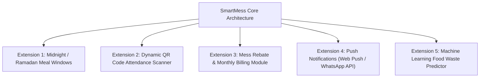

# SmartMess – Quality Assurance, Deployment & Maintenance Manual
**Document ID:** SM-SDLC-07  
**Version:** 1.0.0  
**Status:** Approved  
**Project:** SmartMess – Smart Hostel Mess Management System  

---

## 1. Quality Assurance (QA) Checklist

The QA framework establishes explicit verification gates across the six core software quality attributes defined in ISO/IEC 25010:

### 1.1 Reliability & Fault Tolerance
* [x] **Render Cold-Start Resilience:** Frontend Axios interceptor detects connection delays and network errors, displaying user-friendly guidance rather than unhandled white-screen crashes.
* [x] **Relational ACID Compliance:** Foreign key cascades (`ON DELETE CASCADE`) on `ratings`, `attendance`, and `complaints` preserve referential integrity when user records are removed.
* [x] **Centralized Exception Obfuscation:** The Express `errorHandler.js` intercepts all uncaught exceptions and obfuscates internal stack traces in non-development environments, preventing information disclosure.
* [x] **Stateless JWT Verification:** Ephemeral tokens eliminate memory-leak risks associated with growing server session tables.

### 1.2 Security & OWASP Top 10 Mapping
* [x] **A01: Broken Access Control:** Enforced via dual-layer middleware (`auth.js` for JWT verification and `roleGuard.js` for role isolation). Students are strictly forbidden from administrative routes (`/api/admin/*`). Students cannot modify other students' ratings or complaints.
* [x] **A02: Cryptographic Failures:** Passwords hashed with `bcrypt` (work factor 10); JWTs signed with HMAC-SHA256 using an externalized 256-bit secret.
* [x] **A03: Injection Attacks:** Parameterized database operations through the Supabase SDK eliminate SQL injection vulnerabilities. Direct SQL concatenation is prohibited. React automatically sanitizes JSX interpolations against Cross-Site Scripting (XSS).
* [x] **A04: Insecure Design:** Student onboarding is partitioned into a two-phase approval lifecycle (`is_verified = false` holding state until warden sign-off). Attendance is restricted by server-validated time windows.
* [x] **A05: Security Misconfiguration:** `helmet` sets HTTP security headers (CSP, HSTS, X-Frame-Options). CORS whitelist blocks cross-origin requests from untrusted origins.
* [x] **A06: Vulnerable Dependencies:** Verified zero high-severity vulnerabilities via `npm audit`.
* [x] **A07: Identification & Authentication Failures:** Auth rate limiter (`express-rate-limit`) throttles brute-force attempts on `/api/auth/*` (max 20 requests per 15 minutes).
* [x] **A08: Software & Data Integrity Failures:** Admin accounts are restricted from public registration and must be provisioned via the secure server CLI script `src/scripts/createAdmin.js`.
* [x] **A09: Logging & Monitoring:** HTTP access logging is performed via `morgan`.

### 1.3 Usability & Accessibility (WCAG 2.1 AA)
* [x] **Mobile-First Responsive Layout:** Tested across viewport widths from 320 px (mobile) to 1920 px (desktop).
* [x] **Explicit Semantic UI States:** Every data view renders dedicated **Loading** (animated spinner), **Empty** (contextual message), and **Error** states.
* [x] **Accessible Contrast:** High-contrast color palette adhering to WCAG 2.1 AA minimum contrast ratio (4.5:1 for normal text).
* [x] **Keyboard Navigability:** Star ratings, modal overlays (Escape key dismissal), and menu controls support keyboard focus.

### 1.4 Performance & Scalability
* [x] **Sub-500ms Response Times:** Database queries on `date`, `roll_number`, and `email` leverage B-tree indexes.
* [x] **Zero Heavy UI/Chart Dependencies:** Built with pure SVG/CSS visualizations and native HTML5 Drag and Drop, keeping frontend bundle size under 250 KB gzipped.

---

## 2. Code Review Checklist & Formatting Standards

Prior to merging any pull request into `main`, the engineering team executes the following review checklist:
1. **Architectural Purity:** Are database queries strictly located within `src/models/*`? Controllers must not issue direct DB queries.
2. **Error Propagation:** Do all asynchronous controller routines wrap operations in `try/catch` and forward exceptions to `next(err)`?
3. **No Hardcoded Secrets:** Are all JWT keys, database URLs, and port configurations read from `process.env`?
4. **Linting & Formatting:**
   ```bash
   # In backend
   npm run lint
   npm run format

   # In frontend
   npm run lint
   ```
5. **Test Validation:** Have automated tests been run with 100% pass rate?
   ```bash
   npm test
   ```

---

## 3. Comprehensive Software Maintenance Plan

### 3.1 Maintenance Types & Concrete SmartMess Scenarios

```
+-----------------------------------------------------------------------------------+
|                        Software Maintenance Classification                        |
+-----------------------------------------------------------------------------------+
| 1. Corrective Maintenance (Bug fixes & urgent patches)                            |
|    Example: Resolving DST or timezone offset shifts in meal window calculation    |
|                                                                                   |
| 2. Adaptive Maintenance (Environment, OS & Platform adjustments)                 |
|    Example: Adapting Supabase client library updates or Node.js runtime upgrades  |
|                                                                                   |
| 3. Perfective Maintenance (User-requested performance & UX improvements)         |
|    Example: Adding instant search debouncing to the student directory table       |
|                                                                                   |
| 4. Preventive Maintenance (Refactoring, tech-debt elimination, dependency audits) |
|    Example: Updating npm dependencies to resolve deprecation warnings             |
+-----------------------------------------------------------------------------------+
```

1. **Corrective Maintenance:**
   * *Scenario:* A student reports that attendance for evening snacks was rejected at 16:35 due to server clock drift.
   * *Action:* Calibrate the server NTP daemon or adjust the `SNACKS_START` environment variable in the Render dashboard without modifying source code.
2. **Adaptive Maintenance:**
   * *Scenario:* Supabase updates its connection pooling endpoint or PostgreSQL major version from 15 to 16.
   * *Action:* Update the `SUPABASE_URL` string and test connection pool stability.
3. **Perfective Maintenance:**
   * *Scenario:* Mess wardens request dark mode support for nighttime shift monitoring.
   * *Action:* Extend CSS variable tokens in `variables.css` with a `[data-theme="dark"]` selector.
4. **Preventive Maintenance:**
   * *Scenario:* Routine quarterly code audit reveals deprecated utility methods.
   * *Action:* Run `npm audit fix` and refactor legacy dependencies.

### 3.2 Semantic Versioning (SemVer) & Release Management
The project adheres to **Semantic Versioning 2.0.0** (`MAJOR.MINOR.PATCH`):
* `PATCH` (e.g., 1.0.1): Backward-compatible bug fixes and patch remediation.
* `MINOR` (e.g., 1.1.0): New backward-compatible functional additions (e.g., adding QR code check-in).
* `MAJOR` (e.g., 2.0.0): Incompatible architectural changes (e.g., changing JWT auth schema to OAuth2/SAML SSO).

---

## 4. Extension Guide (Future Modular Enhancements)

The system is architected for modular extension without requiring database rewrites:



1. **Adding a New Meal Window (e.g., Late Night Supper / Special Ramadan Iftar):**
   * *Database:* Add column `supper BOOLEAN DEFAULT FALSE` to `attendance` table; alter `meal_type` CHECK constraint in `ratings` to include `'supper'`.
   * *Backend:* Add `SUPPER_START` and `SUPPER_END` to `.env` and `utils/timeWindows.js`.
   * *Frontend:* Add `{ key: 'supper', label: 'Late Night Supper' }` to `meals` array in `TodayMenu.jsx` and `Attendance.jsx`.
2. **Dynamic QR Code Attendance Check-In:**
   * *Concept:* A tablet displayed at the mess counter generates a time-rotating cryptographic TOTP QR code every 15 seconds.
   * *Implementation:* Students scan the QR code via their phone camera; the client sends the signed TOTP to `POST /api/student/attendance` for counter verification.
3. **Mess Rebate & Billing Module:**
   * *Concept:* Track consecutive days of missed meals (rebates) and deduct from monthly hostel mess invoices.
   * *Implementation:* Query `attendance` table for contiguous false days $\ge 3$, generating billing credit adjustments.
4. **Automated WhatsApp / Email Alerts:**
   * *Implementation:* Add a webhook trigger on `complaints` updates to send a WhatsApp notification via Twilio when the warden resolves an issue.
5. **Machine Learning Demand Forecasting (Holt-Winters / Prophet):**
   * *Implementation:* Replace the 7-day simple moving average in `Attendance.getMovingAverageForecast()` with an ARIMA or Prophet microservice that accounts for exam weeks, festivals, and weekends.

---

## 5. Known Limitations & Technical Debt

1. **Render Free-Tier Spin-Up Delay:**  
   Render's free tier spins down inactive web services after 15 minutes of inactivity. First requests after idle periods encounter a ~50-second wake-up latency. *Workaround:* Use a cron ping service (e.g., cron-job.org) or upgrade to Render Starter ($7/month).
2. **Client-Side Attendance Window Reliance on Server Time:**  
   While the server strictly rejects check-ins outside active hours, clients with incorrect local system clocks may see buttons enable or disable a few seconds out of sync until a network call refreshes the server timestamp.
3. **Array Data Types in PostgreSQL:**  
   Dish items are stored as PostgreSQL native `text[]` arrays. While highly performant for daily schedules, querying dish-level statistics across millions of rows requires unnesting arrays (`unnest(lunch)`). For campus operations with < 5,000 residents, performance is optimal.
